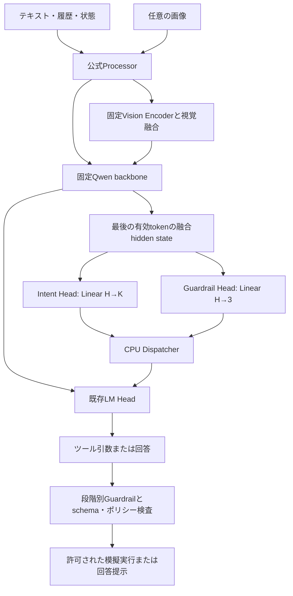

# アーキテクチャ推奨案

## 結論

Frozen Qwen3.5-2B（Vision Encoder含む）＋Linear Intent Head＋Linear Guardrail Head＋既存LM Head。
独立Router Headは置かない。CPUのDispatcherがIntent、Guardrail、確定的なポリシー検査、引数の完全性を使って処理先を決める。
一般対話と画像QAは既存生成経路。ツール引数も既存LM Headで生成する。

## 要件との対応

|要求|担当|
|---|---|
|模擬ツール選択|Intent Head|
|ツール引数決定|定型の引数はCPU抽出/小型Slot Head。自由な引数は既存LM Headのツール呼出し生成＋schema検証|
|模擬実行と結果への応答|CPU実行器＋既存LM Head|
|一般対話|既存LM Head|
|一般画像の説明/QA|既存Vision Encoder＋融合backbone＋LM Head|
|入力・応答の危険内容/不正指示|Guardrail Head。入力/出力段階を区別|
|操作の実行可否|Guardrail Head＋状態・引数・許可の確定的チェック|

## なぜ「分類Head 1個」から拡張するか

Intent→CPUの対応表という提案は妥当で、Router Headと細粒度Intent Headを重ねる必要はない。
ただしREJECTをIntentの一種にすると、操作種別と許可状態という異なる軸を単一ラベルへ押し込む。
同じトランク開の依頼でも、車両状態により許可/確認/禁止が変わる。Intentは同じでもGuardrailの正解は異なる。
加えて、生成された引数や応答の安全性は入力だけから確定できない。生成後の別判定が必要。

## 構造

図は論理構造。初期の「同じhidden stateから並列Head」は入力段階を指す。
操作前/出力後のGuardrail判定は、生成された引数/回答を含む別入力からhidden stateを計算する。最初のhだけで未来の出力を判定できると仮定しない。

## Head仕様の初期案

Intent Head: K=採用ツール数＋NO_TOOL＋UNKNOWN等。最初は単一ツール呼出し、曖昧/複合依頼は確認へ送る。ラベル数はツール仕様から決め、20に固定しない。
NO_TOOLには一般対話と画像QAを含めてよい。画像の有無はProcessorが既に知っているため、分類だけのためのIMAGEクラスは不要。画像依存のツール選択には融合特徴を使う。

Guardrail Head: ALLOW / REVIEW / BLOCK。
操作段階では実行可/要確認/実行不可に対応。入力・出力段階では回答可/保留して確認または再生成/拒否または非提示という段階別の動作に対応する。
同じ3出力でも、段階ごとにラベル定義と評価セットを作る。まず段階条件付きの1個のLinear Headを共有する案とし、性能が足りなければ入力/操作/出力別Headへ分割する。
安全性の理由分類やconfidence calibrationは後続。softmax最大値をそのまま真の確率と扱わない。

Qwen3.5-2Bの公式text hidden sizeは2048、vocab sizeは248320。実装ではconfigから取得する。追加パラメータ数はbias込みで2049×(K+3)。既存LM Headは概ね2048→248320でEmbeddingと重み共有しているため、Head追加で共有関係を壊さない。

## 実行順序

1. 入力（任意画像と状態を含む）をprefillし、Intentと入力Guardrailを判定。
2. BLOCKなら拒否、REVIEWなら確認、ALLOWならIntentに応じて処理。
3. ツールの場合、定型引数はCPUの限定的な抽出器または別のSlot Headで決定する。自由な引数が必要な場合は、既存LM Headに公式chat templateのツール形式で生成させる。分類結果と生成tool名の不一致は実行せず記録する。
4. schema、引数の範囲、対象、権限、状態を検証。実行前Guardrailには完成した操作案を与える。
5. ALLOWのみ模擬実行。結果をモデルへ返し、説明を生成。
6. 一般対話・画像QA・ツール結果説明を含め、提示前の出力Guardrailを実施。
7. 初期は回答を一度バッファし、判定前のtokenをユーザーへストリームしない。

Direct Toolは「不要な対話を挟まず許可された処理へ進む」という意味に限定する。定型引数がCPUで得られるときは、LM Headを通さず、検査後に固定文で応答できる。Intentが分かっただけで引数の正しさや操作許可が保証されたことにはしない。
Qwen3.5-2Bの公式chat templateが要求するツール呼出し本文は`<tool_call><function=...><parameter=...>`形式で、JSON文字列の直接出力ではない。tool定義はJSON schemaとして入力され得るが、出力はtemplateに合わせて解析する。アプリ内部で型付き構造体/JSONへ変換し、schema検証を行う。「JSONとして生成させれば正しい」とは仮定しない。
2Bモデルの自由引数生成は未検証のため、まず公式のHeadなしツール呼出し、Head選択＋モデル引数生成、Head選択＋定型抽出の3案を同じ模擬ツールで比較する。構文、引数完全性/意味一致、不要呼出し、未許可操作、応答、レイテンシを測る。
初期版は各段階を独立に実行し、機能と計測を優先。prefill/KV共有や追加forwardの削減はその後に行う。Guardrail passのコストをHead単体のコストに隠さない。

## 評価上の分離

生のQwen生成: 同一入力条件で学習前後の重み/logits/token列の不変性を確認する。
システム挙動: Headが正しい経路を選び、必要な確認/拒否/実行をするかを確認する。経路制御により応答が変わること自体は生成破壊を意味しない。
Baseline: 追加HeadなしのQwen＋同じツールschema/同じ確定的検査と比較し、Head追加の効果を測る。

## 比較範囲

Linear対MLP: 同じQwen固定融合特徴、同じラベル/分割/評価。
BERT: テキストのみのIntentとGuardrail分類を比較。画像QA、生成、画像依存の安全性をBERT単体で代替できるとはしない。
SoCへの載せやすさはHeadの単純さだけで判断しない。本体の線形Attention、視覚Encoder、状態cache、複数判定pass、量子化を別途検証する。

## 出典

- https://huggingface.co/Qwen/Qwen3.5-2B/raw/main/config.json
- https://huggingface.co/docs/transformers/model_doc/qwen3_5
- https://huggingface.co/Qwen/Qwen3.5-2B/raw/main/chat_template.jinja
